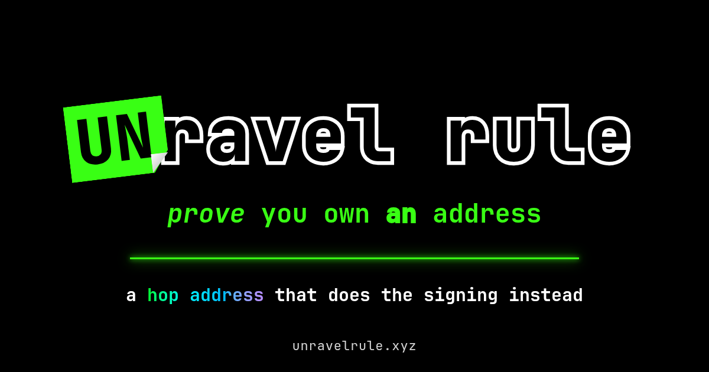

[](https://unravelrule.xyz/)

# Proof-of-ownership deposit address

Exchanges increasingly ask you to prove you own your withdrawal address by signing a challenge message. Cold storage often can't do that: taproot on some devices, multisig, air-gapped setups. The fallbacks they offer (xpub, descriptor, Satoshi test) either leak your whole wallet or need a spend from cold storage.

This tool gives you a one-purpose hop address that *can* sign the challenge, and that forwards the funds to your cold wallet. It is built so that nobody can steal from it and nothing gets lost.

## How it works

You paste one taproot receive address from your wallet. Nothing else. This is the destination.

1. **Create the hop address.** Your browser makes a key. The service has a key of its own. The tool builds the hop address, a taproot address with two ways to spend:

   | Path | Who can spend | Used for |
   |---|---|---|
   | Key path | The browser key and the server key together (MuSig2) | Signing the challenge, and the normal forward to the destination |
   | Hidden leaf | The destination's own key, any time | Safety net |

   The destination's key is read straight from the address: a `bc1p` address *is* a public key.
2. **Verify.** Enter the hop address at the exchange. Paste its challenge into the tool. The browser and the server sign it together, and you get an ordinary BIP-322 signature to paste back. The exchange can't tell it was signed by two parties.
3. **Withdraw** to the hop address.
4. **Forward.** Once the deposit confirms, the browser and the server sign one transaction that pays the destination, minus the miner fee.

### Depositing to an exchange

Some exchanges ask you to prove you own the address a deposit comes from. The page's other mode makes a hop address for that: you give the exchange's deposit address and your wallet's taproot address. The exchange's address may be P2PKH, P2SH, P2WPKH, P2WSH or P2TR. You send from your wallet to the hop address, sign the exchange's message with it, and it forwards to the exchange. Your wallet keeps the safety net, and a deposit the exchange sends back to the hop address can be forwarded to your wallet instead. The page sends the first coins at a hop address like this to the exchange. Anything that arrives after a forward may be a returned deposit, so for that the page waits for you to choose, rather than sending it straight back, and it signs only a forward to the address you chose.

The hop address commits to the exchange's address through a tweak of the server's key (see [Protocol](#protocol)), so a page can't register the same hop address again with another exchange address.

Recovering such a hop address needs the exchange's address as well as the rescue key, the server key and your wallet's address. The kit lists each exchange address used up to when it was saved, so the page asks you to save it again after a new one, and the exchange's deposit history has the address too. The server learns your wallet's address and the exchange's together, and an exchange's deposit address usually identifies an account.

## Goals

- **Privacy.** Protect your financial privacy from evil. What an exchange collects goes into a database next to your passport and home address, then on to its compliance and chain-analytics vendors. These databases leak, and a leak is a shopping list for [wrench attackers](https://github.com/jlopp/physical-bitcoin-attacks). Here the exchange learns only the hop address, and later sees it pay the destination: no more than if you'd withdrawn there directly. It never sees an xpub or a descriptor. The safety-net leaf stays hidden unless it's used.
- **No theft.** The browser key alone can't move the funds. The server key alone can't move them either. Together they only sign the forward to the destination, or, for a hop address that deposits to an exchange, to the exchange or your wallet.
- **No loss.** If your browser loses its key, or the service disappears, the funds stay at the hop address. Your cold wallet can spend them through the safety net, given the hop address's descriptor, `tr(<shared key>,pk(<destination's key>))`. The control block needs the shared key, which the address doesn't reveal. The emergency kit (the rescue key and the server's public key) rebuilds it, so the user saves one kit rather than a descriptor per address. A hop address that deposits to an exchange also needs the exchange's address, which the kit lists.
- **Trust minimization.** Neither key alone can move the funds, and the safety net needs neither. What's left to trust is the page's code. Its JavaScript creates the browser key, so malicious page code would give the operator both keys, and it could take deposits on arrival. Checking the descriptor can't detect this: the shared key is one opaque key. Running the browser client from your own machine means checking that code once, rather than trusting whatever the site serves on each visit.
- **Honest proof.** You really do control the hop address: through the browser key, and through the destination's key.

## Fees

There is no service fee: the forward pays the destination, minus the miner fee. An output to the service would cost users block space, and would link every user once the service swept its fee coins together. The code for an optional fee output is still there, and the tests exercise it.

## Limits

- **You must come back once per deposit.** The forward needs the browser key, which lives in your browser. Either keep the tab open until the deposit confirms, or revisit the page later. If you never return, the funds sit safely at the hop address behind the safety net.
- **The hop address gets reused.** Exchanges remember verified addresses, so each later withdrawal to it needs its own forward.
- **The destination must be taproot, with a spendable key path.**
  - Single-sig works. MuSig and FROST key paths give a valid hop address, but `just rescue` can't sign their safety net: it needs one plain secret key.
  - Script-only multisig with an unspendable internal key doesn't: its safety net would be dead.
  - A non-taproot destination can't be supported from the address alone.
- **The safety net needs wallet support.** The wallet has to sign a tapscript leaf with its *tweaked* output key. No hardware wallet does this today, so the fallback is software that signs from the seed on an offline machine: `just rescue` with Bitcoin Core (see [Spending through the safety net](#spending-through-the-safety-net)). That breaks cold storage, but only in an emergency.
- **The exchange must verify BIP-322 for taproot.** Bitaroo appears to (it accepts Sparrow's taproot signatures). BIP-137 isn't supported, because a single key can't hide a safety net.

## Why this design

- **The service holds the hop address's key.** Any key that can sign the challenge for the hop address can also spend it, so the service could steal. Ruled out.
- **The browser key alone.** If it leaks, the funds can be stolen. If it is lost, they're gone without a safety net. Pairing it with the server key fixes the first problem; the leaf fixes the second.
- **Presign the forward up front.** Impossible: a signature has to name the exact coin, and the exchange creates that coin later.
- **Covenants (CTV, APO, CAT).** These would make the forward fully automatic, but none is active on mainnet. The hop address can gain a covenant leaf later without changing the user flow.
- **Adaptor signatures, HTLCs, bonds.** None of them can constrain a key that can sign whatever it likes.

## Implementation notes

- Watch the hop address by address, not txid. Exchanges can RBF-bump a withdrawal before it confirms, which changes the txid. Track mempool evictions too: a replacement seen in the same second as the original is otherwise a tie.
- Forward a withdrawal after one or more confirmations, so an exchange's fee bump doesn't drop the forward. A deposit to an exchange comes from the user's own wallet and goes on unconfirmed. Build the forward from the amount that actually arrived, since exchanges deduct their fees.
- MuSig2 nonces (BIP327): never persist or reuse a secret nonce. Run a fresh session for each signature.
- Check that the destination's key is a valid curve point. Reject non-`bc1p` addresses.
- Each side computes the sighash itself from the task (challenge text or forward transaction). Neither signs a hash it was handed.
- The proof is plain base64, without BIP-322 v2's optional `smp` prefix, because older verifiers don't expect it.

## Protocol

The browser key is derived from a per-browser rescue key that the user backs up once. With the rescue key, the destination address, the server's public key and, for a hop address that deposits to an exchange, the exchange's deposit address, anyone can rebuild the hop address's shared key and spend through the safety net, even if the browser and the service are gone.

TaggedHash(tag, m) = SHA256(SHA256(tag) ‖ SHA256(tag) ‖ m), as in BIP-340. Where a scalar is needed, it is read as a big-endian integer mod n.

- The rescue key R is 16 random bytes from the OS's CSPRNG. Its checksum C is the first 2 bytes of TaggedHash("unravel/rescue-key/v1", R).
- R‖C is shown as lowercase hex, 36 characters, in 9 groups of 4 joined by `-`. Parsing ignores case, whitespace and dashes, and rejects a wrong length or checksum.
- The browser key's secret is TaggedHash("unravel/browser-key/v1", R ‖ scriptPubKey(destination)). The browser key is that secret times G.
- For a hop address that deposits to exchange address E, the server key S is tweaked: S′ = S + t·G, where t = TaggedHash("unravel/exchange/v1", S ‖ scriptPubKey(E)). S is the 33-byte compressed key the kit shows, and scriptPubKey(E) is the raw script with no length prefix. Without an exchange address, or with one equal to the destination, S is used as is.
- The shared key is BIP-327 KeyAgg(browser key, S or S′), in that order with no sorting. The hop address is `tr(<shared key>,pk(<destination's key>))`.

## Status

Written in Rust (`src/`), using secp256kfun's MuSig2, rust-bitcoin, Electrum to watch hop addresses on real networks, and bdk_chain on the regtest demo. Not audited. It runs on mainnet and is experimental: use small amounts.

`just test` runs the unit tests, then end-to-end tests against a regtest Bitcoin Core that the `bitcoind` crate downloads. They cover the challenge proof verifying as an ordinary single-key BIP-322 signature, forwarding through an exchange's RBF bump, the signing rules each side enforces, and sweeping through the safety net with both keys gone.

## Spending through the safety net

No wallet signs the leaf from a seed, but Bitcoin Core signs it from a descriptor that holds the destination's tweaked private key: `tr(<shared key>,pk(<tweaked key as WIF>))`. `just rescue` makes that descriptor offline:

```
just rescue <kit file> <hop address> [exchange deposit address...]
```

It reads the kit, then the seed words and passphrase (or an xprv) from the terminal without showing them. It searches the wallet's BIP-86 addresses (the first 1000 receive and change addresses of accounts 0 to 2, alone and with each exchange address the kit lists or the command line gives) for the one that makes the hop address. Then it prints the Bitcoin Core commands: import the descriptor into a new blank wallet, and `sendall` back to that address. Run it from inside the repo; the kit path is relative to where you run it. Build it once while online (`cargo build --locked --release -p unravel-rescue`); after that it needs no network, and a run takes a few seconds.

## Running it

`just demo` builds the browser side to WASM and starts the service at http://127.0.0.1:8322 with its own regtest node. `just mainnet` runs it on Bitcoin mainnet instead, reading the chain from Blockstream's public Electrum server, with another public one as a fallback. Its first run needs `UNRAVEL_CREATE_KEY=1 just mainnet` to make the server key in `~/.config/unravel-rule/bitcoin.key`; back that file up, and leave the variable off after that.

### Running it publicly

The server speaks plain HTTP on 127.0.0.1:8322 (`UNRAVEL_ADDR`), with 8 workers and no timeouts. Twelve clients trickling request bodies stop it answering. Keep it on localhost behind a reverse proxy that terminates TLS, passes on only whole requests and keeps no access log. unravelrule.xyz runs Caddy with `deploy/Caddyfile`, which has no per-IP limits because stock Caddy has none. `deploy/nginx.conf` does the same with nginx and also limits each IP address to 10 API requests a second and 20 connections.

The page does a proof of work before the server stores a new hop address: 20 leading zero bits of SHA-256, about a quarter of a second in a desktop browser. The server checks it with one hash. Filling its memory then costs CPU, and it keeps at most 100,000 hop addresses, forgetting the oldest. A page whose hop address was forgotten registers it again. A GPU searches far faster than a browser, so this slows an attacker rather than stopping one.

Each open page asks the server about its hop address every two seconds, and each time the server asks its Electrum server. A public one may limit that, and then forwards stop for everyone. Run Bitcoin Core with your own Electrum server (electrs or Fulcrum) and point `UNRAVEL_ELECTRUM` at it, as `tcp://host:port` or `ssl://host:port`, or a comma-separated list tried in order. The server refuses one on the wrong network.

The server keeps one file beside the server key, `bitcoin-stats` (the prefix is the network's name), with running totals: forwards and sats by direction (withdrawals to the destination, deposits to the exchange, and deposits returned to the wallet), proofs signed, failed broadcasts, and how long forwarded deposits had waited. Totals only: no addresses, txids or times. There is no endpoint for it, because comparing two readings would tie a jump to one transaction on chain. Read it on the server.

`deploy/` holds example config for a server: `unravel.env` for the settings and `unravel-server.service` to run it under systemd. To install:

```sh
just wasm
cargo build --locked --release -p unravel-server
sudo install -D target/release/unravel-server /opt/unravel-rule/unravel-server
sudo mkdir -p /opt/unravel-rule/web && sudo cp -r web/static web/pkg /opt/unravel-rule/web/
sudo cp deploy/unravel.env /etc/unravel-rule.env
sudo cp deploy/unravel-server.service /etc/systemd/system/
sudo useradd --system --home-dir /var/lib/unravel-rule unravel
sudo systemctl daemon-reload
sudo systemctl enable --now unravel-server
```

The first start needs `UNRAVEL_CREATE_KEY=1` in the env file to make the server key. Take it out again afterwards and back the key up. Without it a missing key stops the server, so a lost state directory or a mistyped path can't quietly become a new key that orphans every outstanding hop address.
